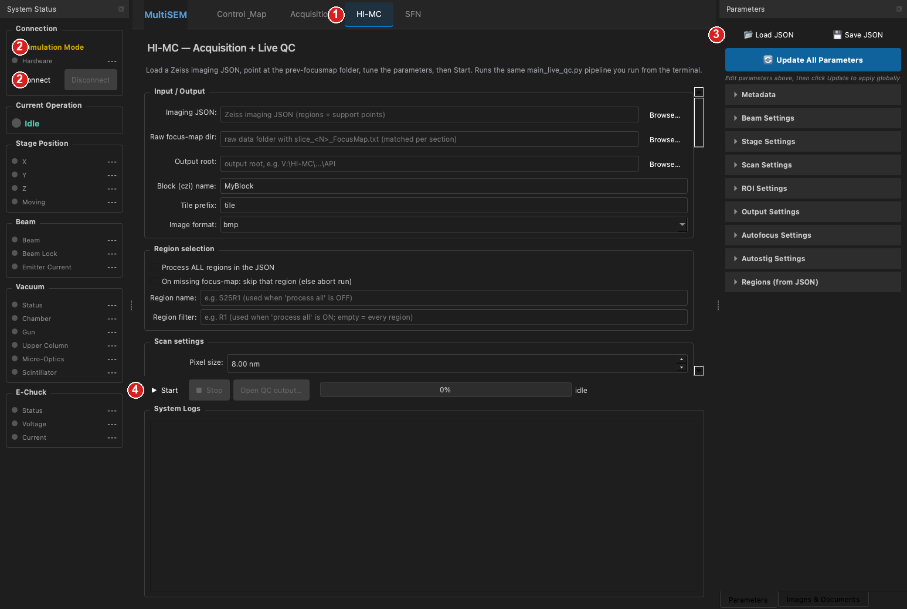
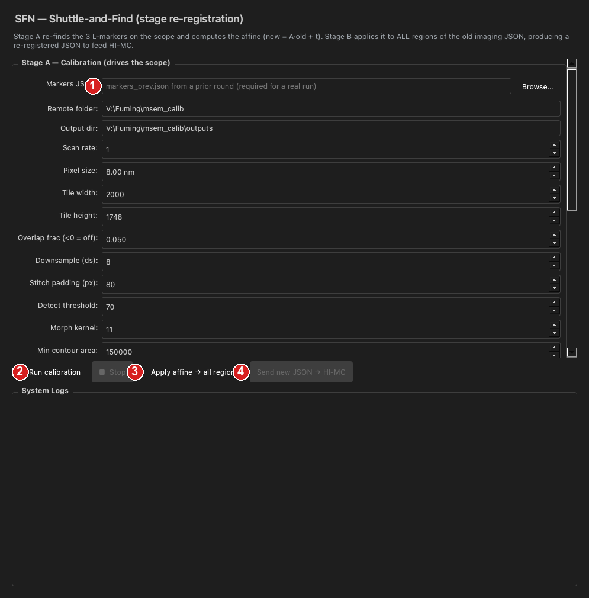
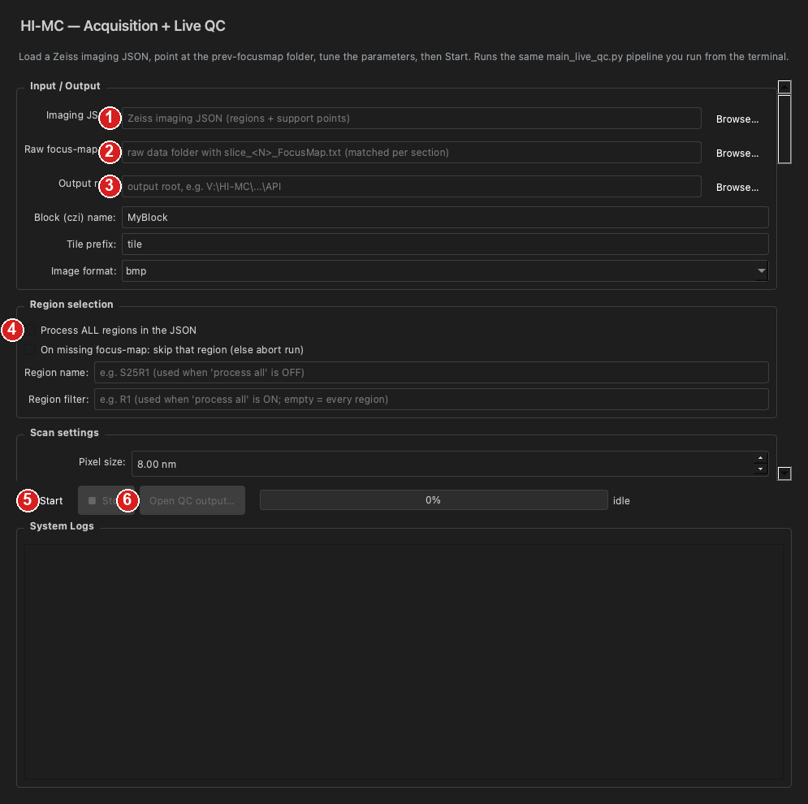

# Operator Guide (illustrated — no coding needed)

Day-to-day operation of the EM acquisition + Live QC software. **You don't need to know any code** — just follow the numbered red circles on the screenshots. All commands are copy-paste.

> Screenshots are rendered in simulation mode; the layout is **identical** on the real instrument (real runs just show live data).

---

## 0. Each time you start: sync the latest version

Open **PowerShell** and paste (the whole block):

```powershell
cd D:\mSEMAPI\himc_app
git pull origin gui-integration
```

> First time, and the `himc_app` folder doesn't exist yet? Create it once (one time only):
> ```powershell
> cd D:\mSEMAPI
> git clone -b gui-integration https://github.com/FumingYang-Felix/Auto-multisem-control-and-QC.git himc_app
> ```

`Already up to date.` or `Updating ...` are both fine.

---

## 1. Launch the software

In the same PowerShell, paste (the whole block):

```powershell
D:\mSEMAPI\mSEMAPI\venv\Scripts\Activate.ps1
cd D:\mSEMAPI\himc_app
python -m msem_control.main
```

`(venv)` appearing before the prompt = the environment is correct. The window opens like this (HI-MC page shown):



Layout: **left** = system status / connection, **top** = the four tabs, **center** = the current page, **right** = parameters panel (Load/Save JSON).
The red circles map to the steps below: **①** switch to the HI-MC page · **②** connect · **③** load JSON · **④** start acquisition.

---

## 2. Connect to the microscope (② in the figure)

In the **System Status** panel on the left:
1. **Uncheck** **Simulation Mode** (unchecked = drive the real instrument; checked = simulation only, touches no hardware).
2. Click **Connect**.
3. The status turns green and vacuum/pressure values start updating = connected.

---

## 3. Load the experiment JSON (③ in the figure)

In the **Parameters** panel on the right → click **📂 Load JSON** → pick this run's imaging JSON (the Zeiss experiment file with regions + support points).
Once loaded, the path is **auto-filled** into both the HI-MC and SFN pages — no need to pick it twice.

---

## 4. (After re-loading a wafer) do SFN re-registration first

> Only needed when you **reload the sample** and the coordinate frame has shifted. Continuing the same wafer → skip this.

Click the **SFN** tab at the top:



**Stage A — run calibration (moves the stage)**
- **① Markers JSON**: pick the previous round's `markers_prev.json` (the 3 L-marker coordinates). **Without it you won't get a meaningful result.**
- Output dir / scan parameters below are fine at defaults.
- Click **② ▶ Run calibration**. The software drives to the 3 markers, images them, finds them, and computes the transform `affine.json`; the log shows `Affine written to: ...` on success (the path is auto-filled below).
- To stop mid-run: click **■ Stop**.

**Stage B — apply the matrix to the old JSON (no stage motion)**
- Affine JSON / Old imaging JSON are already auto-filled.
- Click **③ Apply affine → all regions** (re-registers every region's coordinates at once).
- On success click **④ Send new JSON → HI-MC** — the re-registered JSON is pushed into the HI-MC page.

---

## 5. HI-MC — acquisition + Live QC (main workflow)

Click the **HI-MC** tab and fill top-to-bottom:



- **① Imaging JSON**: already auto-filled (or Browse yourself).
- **② Raw focus-map dir**: point at the **raw data folder** containing `slice_<N>_FocusMap.txt` (one per section). The software matches by section number automatically — **no renaming needed**.
- **③ Output root**: where acquisition results go.
- **④ Region selection** (pick one):
  - **Whole wafer**: tick **Process ALL regions in the JSON**. Before starting, the software **checks every section's focus-map is present**; if any is missing it **aborts before acquiring** by default. Want "skip the missing ones and image the rest"? tick the line below, **On missing focus-map: skip that region**.
  - **A single region**: enter a **Region name** like `S25R1` (don't tick Process ALL in this case).
- Other parameters (Scan / Route / Live QC / Stage / Autofocus / Autostig…) are fine at defaults; change them inline if needed. The **Advanced overrides** box at the bottom takes `key = value` (one per line) for any advanced setting.
- **⑤ ▶ Start** to begin. **System Logs** scrolls live; the progress bar shows `region x/total — tile a/b`. To stop, click **■ Stop** (don't just close the window).
- **⑥ Open QC output…**: after a section finishes, one click opens that section's QC folder.

---

## 6. Where the results go

```
<Output root>\
  w13_h25_Slice1_8NM_20260629_143012\     <- one block (name = JSON name + pixel + timestamp)
    S25R1\                                 <- region
      mfov42\                              <- one folder per MFOV
        mfov42_<timestamp>__001.bmp        <- beam image (the 3 digits after __ = beam number)
        ...
        overview_mfov.png                  <- downsampled overview of this MFOV
      LiveQC\
        live_qc_dashboard.png / .html      <- 5-panel overview + clickable retake page
        live_qc_results.csv                <- one row per MFOV
        live_qc_region_overview.png        <- downsampled overview of the whole region
```

---

## 7. Troubleshooting

| Symptom | What to do |
|---|---|
| No HI-MC / SFN tab | Not synced to latest. Redo step 0 `git pull`; confirm you're not on an old version. |
| Start says no imaging JSON | Do step 3 (Load JSON) first. |
| Process ALL shows `[Preflight] FAILED` | A section's `slice_<N>_FocusMap.txt` isn't in the Raw focus-map dir; add the file, or tick "skip that region". |
| Need to stop mid-acquisition | Click **■ Stop** (don't just close the window). |
| Software lags / errors | Screenshot the red lines in **System Logs** and send them to the developer. |

---

## 8. One-line cheat sheet

**Sync → launch → Connect (uncheck Simulation) → Load JSON → (SFN only when reloading a wafer) → HI-MC fill the three paths → Start.**
